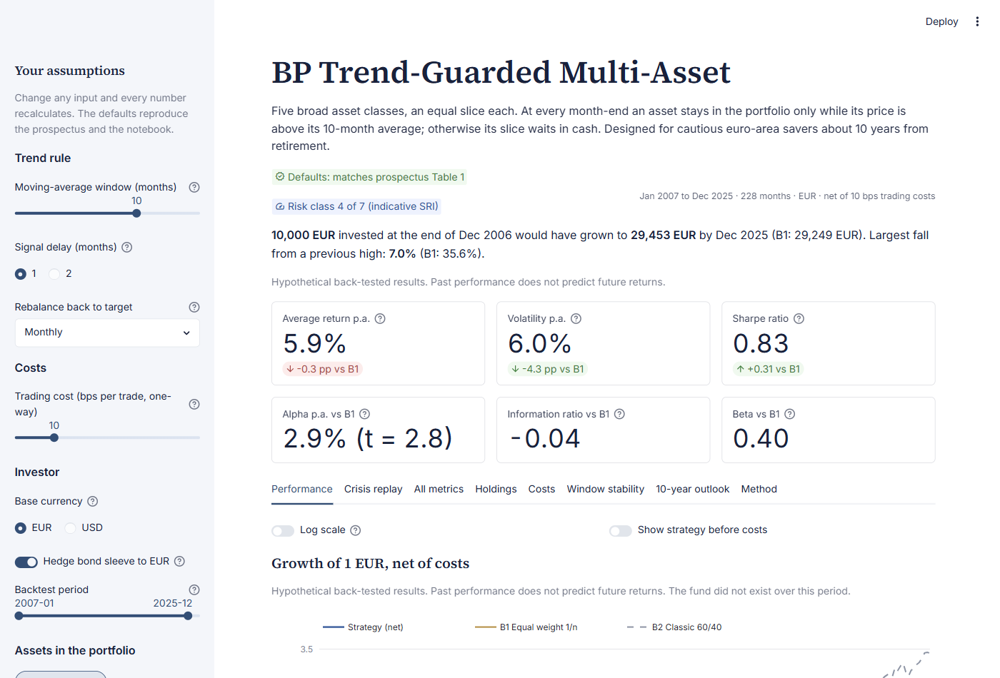
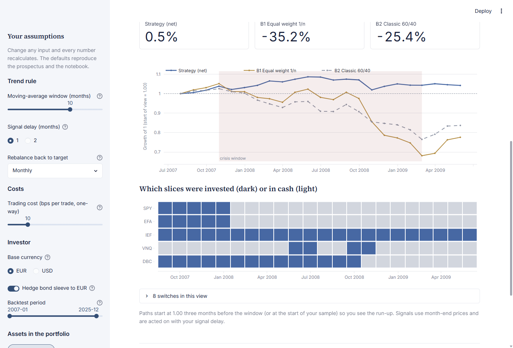

# BP Trend-Guarded Multi-Asset: interactive backtest

Streamlit app for the group assignment of **2270 Financial Modeling, Nova SBE (Fall 2026), Group BP**:
Tim Fischer, David Konrad Belschak, Tom Nico H Croe, Lennart Schmülling, Fridolin Treibig, Bastian Volkery.

**Live app:** `https://<app-name>.streamlit.app` (added after deployment)
**Notebook:** submitted with the investor prospectus (Colab link added here once shared)



## What it does

The strategy holds five broad asset classes (US equity, developed ex-US equity, US Treasuries 7-10y, US REITs,
broad commodities) in equal capital slices. At each month-end an asset stays invested only while its price is above
its 10-month moving average (Faber 2007); otherwise its slice moves to cash.

In the sidebar you change the assumptions and every number recalculates:

| Assumption | Default (= prospectus) | Range |
|---|---|---|
| Moving-average window | 10 months | 6 to 12 |
| Signal delay | 1 month | 1 or 2 |
| Rebalancing back to equal slices | Monthly | monthly, quarterly, annually, never |
| Trading cost (one-way) | 10 bps (fund level) | 0 to 100 bps (50 = retail stress case) |
| Base currency | EUR | EUR or USD |
| Hedge bond slice to EUR | on | on / off (EUR view) |
| Backtest period | Jan 2007 to Dec 2025 | Jan 2007 to the last complete month |
| Assets | all five | any two or more |
| Benchmark for alpha, beta, IR | B1 equal weight 1/n | B1 or B2 (60/40) |

The page shows the six measures the brief requires (annualised average return, volatility, Sharpe ratio, alpha,
information ratio and beta, the latter not annualised) with plain-English explanations; the growth of 1 for the
strategy and both benchmarks from the same start date; drawdowns; calendar-year returns; holdings over time;
turnover, cost drag and breakeven costs (on return and on Sharpe); a 10-year Monte Carlo outlook for 10,000 EUR
(P10/P50/P90, with a cautious variant that halves the historical excess return);
the indicative PRIIPs risk class; a full metrics table with CSV download; and the method.

Two views go beyond the headline numbers:

- **Crisis replay**: the 2008 financial crisis, the 2011 euro crisis, the 2020 Covid crash, the 2022 rate shock and
  the February to April 2025 tariff shock. Strategy against both benchmarks through each window, plus a month-by-month
  strip of which slices were invested or in cash, and the list of switches.
- **Window stability**: the 6, 8, 10 and 12-month windows side by side on one common sample. It is a check that the
  result does not hinge on the 10 months from the paper, not a menu: choosing the best-looking window afterwards would
  be data-snooping.



## Same calculations as the notebook

`fm_backtest.py` is the **unchanged engine file** of the submitted notebook (the notebook writes it with
`%%writefile`). The app never re-implements a calculation: `core.py` only maps the sidebar to the engine's `CONFIG`
and calls engine functions (`run_backtest`, `metrics_table`, `turnover_stats`, `breakeven_cost`,
`cost_sensitivity`, `annual_returns`, `sri_priips`, `monte_carlo`). The footer and the Method tab print the engine
version and SHA-256, which the notebook prints too, and the git commit of the running code.

Tests (`pytest -q`):

- `test_engine_identity.py`: the app's engine is byte-identical to the engine inside the notebook
  (`%%writefile` cells of the .ipynb) and to the group's engine file.
- `test_consistency_with_notebook.py`: the app's defaults reproduce the notebook's `results.json`.
- `test_app_core.py`: app defaults equal the notebook `CONFIG` exactly; every setting runs; series start at 1.00;
  a benchmark against itself gives beta 1, alpha 0, tracking error 0.
- `test_app_ui.py`: the real page, driven headlessly: required measures shown, settings keep each other, reset works.

To point the identity and consistency tests at the notebook, put the notebook folder path in
`tests/local_notebook_dir.txt` (git-ignored) or set `FM_NOTEBOOK_DIR`, or copy the .ipynb into `notebook/`.
GitHub Actions runs all tests on the pinned `requirements.txt`.

## Data

Live, through the engine's own loader (no API keys, no data files needed): Yahoo Finance adjusted closes
(via `yfinance`, falling back to Yahoo's chart API, same data), the ECB Data Portal for the euro overnight rate
(EONIA to September 2019, then the euro short-term rate), FRED for the US T-bill rate and the EUR/USD rate. One
batched download, cached for 12 hours.

Yahoo sometimes throttles shared cloud servers. The app then shows "Live data unavailable, showing snapshot as of
...", never a traceback, and uses `data/snapshot_inputs.csv`: the same monthly inputs, saved with the engine's own
`snapshot_frame` (`python tools/make_snapshot.py` refreshes it). "Data source" in the sidebar selects it explicitly.

## Run locally

```bash
pip install -r requirements.txt
streamlit run app.py
```

Python 3.11 to 3.13. Tests: `pip install pytest` then `pytest -q`.

## Deploy on Streamlit Community Cloud (one group member, about 5 minutes)

Before deploying, decide how graders get access (group decision, after sign-off):

- **(a) Repository and app public** (cleanest). A group member switches this repository to public
  (Settings, General, Danger Zone, Change visibility), then deploys; apps from public repositories are public.
- **(b) Repository private, graders invited on GitHub, app public.** Deploy from the private repository, then in the
  app's **Share** menu choose **"Make this app public"**.

Keep in mind: an account can have only **one private app** at a time, and a private app can only be opened by
invited viewers, so graders would need invitations. Choose (a) or (b) so the app itself is public.

Steps:

1. Go to `https://share.streamlit.io` and sign in with GitHub. Allow access to this repository when asked
   (for a private repository, allow private repository access).
2. Click **Create app**, then **"Yup, I have an app"**.
3. Repository `belschak/fm-2270-backtest-app`, branch `main`, main file path `app.py`.
4. App URL: choose a short subdomain, for example `bp-trend-guarded`.
5. Open **Advanced settings** and choose **Python 3.13**. The Python version is chosen once: changing it later means
   deleting and redeploying the app. No secrets are needed. Save.
6. Click **Deploy**. The first build takes a few minutes; then the app downloads the data once (about 15 seconds).
7. For option (b): **Share**, then **"Make this app public"**.
8. Put both links (app URL and `https://github.com/belschak/fm-2270-backtest-app`) in the prospectus and the
   notebook, fill `NOTEBOOK_URL` in `app.py`, and check both links in a private browser window.

Apps on Community Cloud **sleep after 12 hours without visitors**. A visitor wakes one with the button
"Yes, get this app back up!", which takes a minute or two. Open the app on the morning of grading.

## Updating after the notebook changes

```bash
python tools/sync_engine.py      # copies the notebook's engine unchanged and prints both SHA-256 hashes
python tools/make_snapshot.py    # refresh the offline snapshot with the same engine
pytest -q
```

## Files

| File | Purpose |
|---|---|
| `app.py` | Streamlit page (UI only) |
| `core.py` | maps sidebar choices to the engine CONFIG, collects results |
| `fm_backtest.py` | shared engine, identical to the notebook |
| `data_layer.py` | live download via the engine, snapshot fallback |
| `charts.py` | Plotly figures in the prospectus colours |
| `.streamlit/config.toml` | theme (light and dark) |
| `tests/`, `tools/` | consistency tests, engine sync, snapshot refresh |

## Use of generative AI

An AI assistant (Claude) proposed the strategy and helped write the code of the notebook and this app. The group
checked the outputs: the app runs the notebook's own engine file (tested byte for byte), its defaults reproduce the
notebook's results (tested), and every setting was exercised in automated tests and by hand.

Educational project, not investment advice. Hypothetical back-tested results. Past performance does not predict
future returns.
